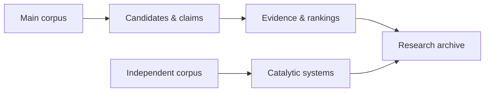

# TEOA consensus-agent

**Literature analysis for additives in photocatalytic CO₂ reduction.**

English · [简体中文](docs/README.zh-CN.md)

The pipeline nominates candidate additives, extracts and groups claims, gathers supporting evidence, and ranks consensus themes. An independent document collection supports a separate analysis of catalytic systems.

This repository includes the source code and synthetic examples. The full literature collection and historical research results are not included.

## Workflow



The workflow runs in 13 stages, with review checkpoints before model calls and explicit approval for online reference retrieval. See the [usage guide](docs/USAGE.md) for stage controls.

## Quick start

Requires **Python 3.11+** and **PowerShell 7 on Windows**. From the repository root:

```powershell
.\setup.cmd
.\agent.cmd run -Stage 1 -RunDirectory ..\teoa-demo
.\agent.cmd status -RunDirectory ..\teoa-demo
```

This parses the synthetic examples without an API key. Results appear in `..\teoa-demo\outputs\01_corpus`; the run then waits for stage 2 approval.

Setup creates a sibling virtual environment named `<repository-folder>.venv`. Keep run directories outside the repository.

## Run with your literature

1. Replace the synthetic examples with parsed JSON documents and update their catalogs. See [Input format](docs/INPUT_FORMAT.en.md).
2. Configure a compatible model API and start a new run. See [Model configuration](docs/USAGE.md#model-configuration).
3. Review and approve each checkpoint as the workflow progresses.

The pipeline treats catalog DOIs as authoritative. Verify each document against its intended DOI and title before analysis; file hashes check integrity, not paper identity.

## Results

Paths below are relative to the run directory.

| Path | Contents |
| --- | --- |
| `outputs/11_ranking/` | Theme rankings and sensitivity analyses |
| `outputs/12_systems/` | Catalytic-system statistics |
| `outputs/13_export/` | Export validation records |
| `delivery/` | Inputs, outputs, and execution records archived by stage 13 |

## Documentation and validation

- [Usage guide](docs/USAGE.md) — API setup, stage approvals, and run controls.
- [Input format](docs/INPUT_FORMAT.en.md) — JSON structures, catalogs, and metadata.
- [Validation record](docs/VALIDATION.en.md) — completed checks and untested scope.

Seven offline tests and the synthetic stage 1 run passed on Windows with Python 3.13 during release preparation. The full online workflow and historical research results have not been reproduced with this release.

## License

[Apache License 2.0](LICENSE). Third-party dependencies retain their respective licenses.
